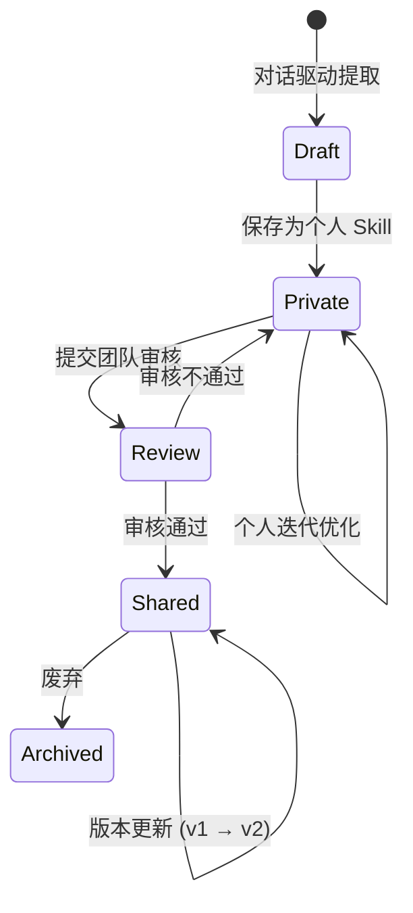
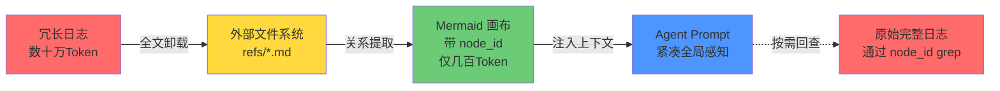
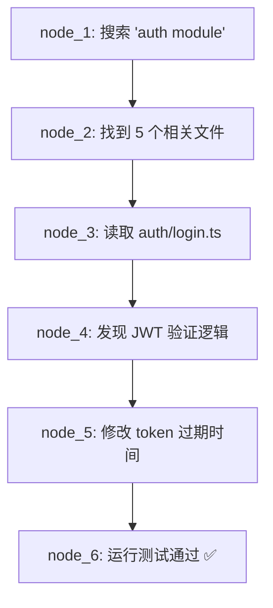
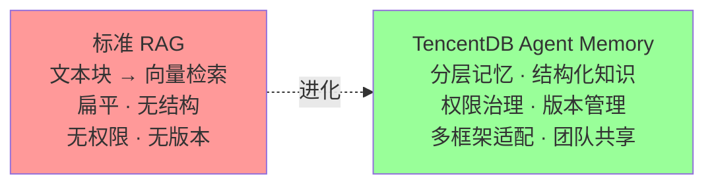

# TencentDB Agent Memory 源码解读 —— 让 Agent 团队拥有「继承式记忆」

> 公司可以很小，经验可以无限复利。

---

## 0. 引言：Agent 的记忆之痛

当前 Agent 落地过程中，几乎所有团队都会遇到同一个根本性矛盾：

**LLM 的无状态性 vs. 业务知识的累积性。**

每开启一个新 session，Agent 就像经历了一次「脑叶切除术」——SOP 要重新讲一遍、项目背景要重新铺垫、输出格式要重新约定。人类用户被迫成了 Agent 的「记忆外挂」，一遍又一遍地重复那些本该被记住的事情。

现有的 RAG（检索增强生成）方案在「找到什么」这个问题上已经做得足够好，但它无法回答更关键的问题：

| 问题 | RAG 的回答 | 实际需要的回答 |
|------|-----------|---------------|
| 这条信息该给哪个 Agent？ | ❌ 不感知 Agent 身份 | ✅ 按角色精确分发 |
| 哪个版本的知识是当前有效的？ | ❌ Chunk 没有版本概念 | ✅ 带版本号、带状态 |
| 这段经验是用户偏好还是事实约束？ | ❌ 扁平文本块，语义模糊 | ✅ 分层结构，类型明确 |
| 这段记忆谁能看、谁能改？ | ❌ 无权限模型 | ✅ 四级 ACL 体系 |
| 改这个代码文件会影响哪些模块？ | ❌ 文本匹配，无调用关系 | ✅ 符号级调用图 |

**TencentDB Agent Memory 的定位恰恰在此：它不是要「存更多」，而是要「存得对、取得准、管得好」。**

本文将深入源码层面，拆解这套记忆系统的架构设计、数据模型、召回策略和治理体系，看看它是如何让 Agent 团队拥有「继承式记忆」的——后入职的 Agent 不必从零开始，而是站在前辈的肩膀上工作。

---

## 1. 项目全景

### 1.1 一句话定位

> **团队级记忆中枢（Team-level Memory Hub）** —— 将对话、文档、代码转化为四种可复用记忆资产（Chat Memory / Skill / LLM-Wiki / Code-Graph），支持治理、共享、跨 Agent 分发。

它不是某个 Agent 框架的专属插件，而是一个**独立运行的 Gateway 服务**，通过 HTTP API 和 SDK 与任意 Agent 框架对接。这种设计哲学贯穿整个项目：记忆是基础设施，不是框架附属品。

### 1.2 核心设计哲学

项目 README 中有一句话精准概括了整个系统的价值链条：

```
已有信息 → 可复用记忆资产 → 更少轮次 → 更少返工 → 更稳结果
```

这五个箭头揭示了一个本质洞察：**记忆系统的价值不在「存储容量」，而在「转化率」**——把原始对话转化为可执行经验（Skill），把文档转化为结构化知识图谱（Wiki），把代码库转化为调用关系图（CodeGraph），最终让 Agent 在更少交互轮次内产出更稳定的结果。

### 1.3 架构双支柱

从源码分析来看，TencentDB Agent Memory 的架构建立在两个核心支柱之上：

#### 支柱一：分层记忆（Memory Layering）

传统 Agent 记忆是扁平的——要么全部上下文塞进 prompt，要么全部丢进向量库检索。TencentDB Agent Memory 将记忆按**时效性、粒度、召回成本**分为四层：

```
┌─────────────────────────────────────────────────┐
│                 L3: Persona                      │
│         长期画像 · 稳定模式 · 用户偏好            │
│           召回频率低 · 生命周期长                 │
├─────────────────────────────────────────────────┤
│                 L2: Scenario                     │
│      按项目/场景组织的知识块 · 工作上下文         │
│           召回频率中 · 按场景索引                 │
├─────────────────────────────────────────────────┤
│                 L1: Atom                         │
│    事实/偏好/约束/事件的原子单元 · 精确召回       │
│           召回频率高 · 支持 BM25 + 向量           │
├─────────────────────────────────────────────────┤
│              L0: Conversation                    │
│         原始对话 · 完整上下文 · 精确核验          │
│           按需回查 · 字符预算保护                 │
└─────────────────────────────────────────────────┘
```

#### 支柱二：符号化上下文卸载（Symbolic Memory）

长任务中最消耗 Token 的往往不是任务本身，而是中间过程——搜索结果、代码片段、错误堆栈动辄数十万 Token。系统采用了一种优雅的三步方案：

1. **全文卸载**：完整工具日志写入外部文件 `refs/*.md`
2. **关系提取**：将任务状态转移编码为 Mermaid 符号图（仅几百 Token）
3. **按需回查**：Agent 通过 `node_id` 精确 grep 召回原始日志

这本质上是一种**「摘要 + 指针」**的上下文管理策略——用极简的符号图维持 Agent 的全局感知，原始细节按需加载，避免上下文窗口被中间过程淹没。

---

## 2. 核心架构：MemoryCore 源码解析

### 2.1 整体架构图

从 `MemoryCore/src/gateway/server.ts` 的源码来看，MemoryCore 是一个典型的分层 Gateway 架构：

```
┌──────────────────────────────────────────────────────────┐
│          OpenClaw / Hermes / 自定义应用 / Claude Code     │
│                     (Agent Frameworks)                    │
└────────────────────────┬─────────────────────────────────┘
                         │ HTTP API / SDK
                         ▼
┌──────────────────────────────────────────────────────────┐
│              MemoryCore Gateway  (:8420)                  │
│                                                          │
│  ┌────────────────────────────────────────────────────┐  │
│  │              Router Layer                          │  │
│  │  /v3/conversation/*  /v3/atomic/*  /v3/scenario/*  │  │
│  │  /v3/skill/*         /v3/meta/*      /v3/knowledge/│  │
│  └────────────────────────────────────────────────────┘  │
│  ┌────────────────────┐  ┌───────────────────────────┐   │
│  │  Memory Layer      │  │  Knowledge Layer          │   │
│  │  (L0/L1/L2/L3)     │  │  (Wiki / CodeGraph)       │   │
│  └────────┬───────────┘  └──────────┬────────────────┘   │
│           │                         │                     │
│  ┌────────┴─────────────────────────┴────────────────┐   │
│  │          Asset Management Metadata                │   │
│  │    (用户 / 团队 / Agent / Skill / 权限)            │   │
│  └─────────────────────────┬─────────────────────────┘   │
│                            │                             │
│  ┌─────────────────────────┴─────────────────────────┐   │
│  │       SQLite + 本地文件系统 (refs/*.md)            │   │
│  └───────────────────────────────────────────────────┘   │
└──────────────────────────────────────────────────────────┘
```

关键设计选择：
- **零外部依赖**：不需要 Redis、Elasticsearch、Milvus 等中间件，只需一个 LLM API
- **SQLite 作为统一存储**：内存、原子、场景、知识元数据全部落入 SQLite，简化部署
- **本地文件系统存储大对象**：`~/.memory-tencentdb/memory-tdai/refs/*.md` 存储完整对话日志，避免数据库膨胀

### 2.2 数据存储设计

#### SQLite 存储模型

从 `MemoryCore/src/core/store/` 源码可以看到，SQLite 主要承载**元数据和索引**：

| 表类别 | 典型表 | 用途 |
|--------|--------|------|
| 对话表 | `conversations`, `messages` | L0 原始对话的元数据（ID、时间、session 映射） |
| 原子表 | `atoms`, `atom_embeddings` | L1 原子记忆的文本 + 向量嵌入 |
| 场景表 | `scenarios`, `scenario_atoms` | L2 场景分组及场景与原子的关联 |
| 画像表 | `personas`, `persona_patterns` | L3 用户画像和长期模式 |
| 知识表 | `knowledge_assets`, `knowledge_links` | Wiki 页面和链接关系 |
| 资产表 | `skills`, `skill_versions`, `skill_resources` | Skill 版本和资源文件 |
| 治理表 | `users`, `teams`, `agents`, `assets`, `permissions` | 用户/团队/Agent/权限模型 |
| 代码图表 | `codegraph_symbols`, `codegraph_calls` | 符号和调用关系索引 |

这种分层存储策略体现了 DDIA 中的**「多模型存储」**思想——不同访问模式的记忆数据采用最适合的存储方式：高频检索的用向量索引，关系查询的用 SQL 表，大文本的走文件系统。

#### 本地文件存储

```
~/.memory-tencentdb/memory-tdai/
├── refs/
│   ├── <task_id>-session-001.md    # 工具调用完整日志
│   ├── <task_id>-session-002.md
│   └── ...
├── skills/
│   ├── <skill_id>/
│   │   ├── v1/
│   │   │   ├── SKILL.md            # Skill 定义文件
│   │   │   └── resources/          # 资源文件
│   │   └── v2/
│   │       ├── SKILL.md
│   │       └── resources/
│   └── ...
└── tdai-gateway.yaml               # 配置文件
```

这种**「元数据在 DB、大对象在文件系统」**的混合存储模式，避免了 SQLite 在处理大文本时的性能退化，同时保持了查询的便利性。

### 2.3 Gateway 配置解析链

配置系统的优先级链设计得非常清晰（对应源码中的配置加载逻辑）：

```
TDAI_GATEWAY_CONFIG=/path/to/config.yaml   ← 最高优先级
         │
         ▼ (不存在时)
./tdai-gateway.yaml                        ← 当前工作目录
         │
         ▼ (不存在时)
~/.memory-tencentdb/memory-tdai/tdai-gateway.yaml  ← 数据目录
         │
         ▼ (不存在时)
环境变量 + 内置默认值                        ← 最低优先级
```

配置文件支持 YAML 和 JSON 两种格式，核心配置项包括：

```yaml
# tdai-gateway.yaml 示例
server:
  port: 8420
  host: "0.0.0.0"

llm:
  memory:
    provider: "openai"
    model: "gpt-4o"
    api_key: "${MEMORY_LLM_API_KEY}"
  proxy:
    provider: "openai"
    model: "gpt-4o-mini"
    api_key: "${PROXY_LLM_API_KEY}"

storage:
  dataDir: "~/.memory-tencentdb/memory-tdai"

embedding:
  provider: "openai"
  model: "text-embedding-3-small"
```

值得注意的设计细节：**两组 LLM 参数（memory 组和 proxy 组）**。memory 组用于高质量记忆蒸馏（需要强推理能力），proxy 组用于日常代理请求（可以用更经济的模型）。这种分离体现了**「按任务复杂度匹配模型」**的成本优化策略。

---

## 3. 四大记忆资产深度拆解

### 3.1 Chat Memory —— L0→L1→L3 分层蒸馏

Chat Memory 是系统最核心的记忆资产，其分层蒸馏机制是整个架构的精髓。

#### 分层架构图

```
                    用户对话输入
                        │
                        ▼
              ┌───────────────────┐
              │    L0: 原始对话     │  ← 完整记录，不做任何压缩
              │  (Conversation)    │     用途：精确核验
              └─────────┬─────────┘
                        │ 自动蒸馏
                        ▼
              ┌───────────────────┐
              │    L1: 原子记忆     │  ← 事实/偏好/约束/事件
              │      (Atom)        │     用途：精确召回
              └─────────┬─────────┘
                        │ 场景聚合
                        ▼
              ┌───────────────────┐
              │    L2: 场景记忆     │  ← 按项目/场景组织
              │    (Scenario)      │     用途：快速上下文恢复
              └─────────┬─────────┘
                        │ 模式提取
                        ▼
              ┌───────────────────┐
              │    L3: 人格画像     │  ← 长期稳定模式
              │     (Persona)      │     用途：语境初始化
              └───────────────────┘
```

#### 各层详解

| 层级 | 存储内容 | 数据结构 | 主要用途 | 典型大小 |
|------|---------|---------|---------|---------|
| **L0** Conversation | 原始对话完整上下文（含时间戳、角色、工具调用） | 结构化消息列表 | 核验精确措辞、追溯决策来源 | 单轮数百~数千 Token |
| **L1** Atom | 事实/偏好/约束/事件的原子单元 | `{type, content, confidence, timestamp, source}` | 精确召回可执行信息，支持 BM25 + 向量混合检索 | 单条 10~500 Token |
| **L2** Scenario | 按项目/场景组织的知识块集合 | `{scenario_id, name, atom_refs, context_block}` | 快速恢复工作上下文（"上周做的 XX 项目进展到…"） | 单场景 500~3000 Token |
| **L3** Persona | 长期画像、稳定模式、用户偏好 | `{pattern_id, description, frequency, last_seen}` | Agent 快速进入用户/团队语境（"用户偏好 Python 而非 Go"） | 画像 200~1000 Token |

#### 召回策略矩阵

系统不是简单地「全部召回」或「全部检索」，而是根据使用场景选择不同的召回策略：

```
┌─────────────────────────────────────────────────────────────────┐
│                      召回策略选择                                │
├──────────┬──────────────────────────────────────────────────────┤
│ 正常启动  │ L2(场景) + L3(画像) → 快速 bootstrap 工作上下文       │
│          │  代价：~500-2000 Token                                │
├──────────┼──────────────────────────────────────────────────────┤
│ 精确查询  │ BM25(关键词) + 向量(语义) + RRF(融合)                 │
│          │  回退路径：L2 → L1 → L0                                │
│          │  用途：Agent 需要精确信息时（"上次部署用的什么参数？"）   │
├──────────┼──────────────────────────────────────────────────────┤
│ 保护机制  │ ① 数量上限：单次召回 N 条记忆                          │
│          │ ② 字符预算：总 Token 不超过上下文窗口的 X%              │
│          │ ③ 超时限制：召回操作不超过 T 秒                        │
│          │  目的：防止记忆淹没上下文窗口（Context Overflow）       │
└──────────┴──────────────────────────────────────────────────────┘
```

这种**「分层 + 预算保护」**的设计，本质上是对 DDIA 中「bounded context」思想的应用——记忆系统必须在提供足够上下文和避免上下文溢出之间找到平衡点。

### 3.2 Skill —— 从对话中提取可执行工作流

#### Skill 的本质

Skill 不是 prompt 片段，而是**一个完整的工作流定义**。从 `/v3/skill/*` API 源码可以看到，一个 Skill 包含：

```
Skill
├── metadata
│   ├── id              # 唯一标识
│   ├── name            # 人类可读名称
│   ├── version         # 语义化版本号 (v1.0.0)
│   ├── status          # draft → private → review → shared
│   ├── owner_id        # 创建者
│   └── team_id         # 所属团队
├── definition
│   ├── trigger         # 触发条件（关键词/意图/场景）
│   ├── boundary        # 执行边界（做什么、不做什么）
│   ├── steps           # 有序执行步骤
│   ├── validation      # 验证规则（如何判断成功）
│   └── resources       # 依赖的资源文件引用
└── history
    ├── versions[]      # 版本历史
    └── audit_log       # 审核记录
```

#### Skill 生命周期



**关键设计点：**

1. **默认为 private**：个人 Skill 默认仅自己可见，团队成员不可见。这避免了「未经验证的经验」污染团队知识库。
2. **审核流转**：从 private 到 shared 需要经过审核流程，确保 Skill 质量。
3. **版本管理**：每个 Skill 支持语义化版本，Agent 可以指定使用特定版本。
4. **资源文件**：Skill 可以附带模板、脚本、配置等资源文件，不是纯文本定义。
5. **搜索路由**：Skill 有自己的搜索索引，Agent 可以根据当前任务自动匹配最合适的 Skill。

#### 对话驱动提取

系统支持从对话中自动提取 Skill 候选。这是一个典型的「从非结构化到结构化」的过程：

```
原始对话（非结构化）
       │
       │ LLM 分析
       ▼
提取候选 Skill 结构
       │
       │ 用户确认/修正
       ▼
保存为 Skill (Draft 状态)
```

这种设计让记忆积累成为一个**渐进式**的过程——先有原始对话，再提取候选，最终沉淀为可复用的工作流。

### 3.3 LLM-Wiki —— 文档的结构化知识图谱

#### 灵感与设计

LLM-Wiki 的灵感来源于 Andrej Karpathy 的 [LLM Wiki Gist](https://gist.github.com/karpathy)——将文档从「线性文本」转化为「结构化页面 + 链接图」。

传统 RAG 对文档的处理方式是：

```
文档 → 切分 Chunk → 向量化 → 检索 Top-K Chunk → 注入上下文
```

这种方式的问题在于：**Agent 失去了文档的全局结构**。它拿到的是零散的文本块，无法理解这些块之间的关系，也无法判断自己需要的是「概述」还是「细节」。

LLM-Wiki 的做法截然不同：

```
文档 → 结构化解析 → Wiki 页面（带标题层级） → 链接图（页面间关系）
                                              ↓
                                    Agent 可按层级下钻
                                    Agent 可查看链接关系
                                    Agent 知道「还需要读什么」
```

#### 知识解析模块

从源码 `MemoryKnowledge/` 知识解析模块可以看到，Wiki 页面的解析过程包括：

1. **结构提取**：识别文档的标题层级、段落、列表、代码块
2. **语义分段**：按主题将内容划分为知识节点
3. **链接发现**：识别文档内部的交叉引用和页面间的关联关系
4. **图谱构建**：构建「页面 → 节点 → 链接」的有向图

最终 Agent 看到的不再是一堆文本块，而是一个**可导航的知识结构**：

```
产品需求文档
├── 📄 概述
├── 📄 功能规格
│   ├── 📄 用户认证
│   │   ├── 🔗 链接到 → 安全规范 Wiki
│   │   └── 🔗 链接到 → 历史方案 Chat Memory
│   ├── 📄 支付模块
│   └── 📄 通知系统
├── 📄 技术架构
│   └── 🔗 链接到 → 架构设计 CodeGraph
└── 📄 上线计划
    └── 🔗 链接到 → 发布检查清单 Skill
```

Agent 不再需要「读完整个文件列表再开工」——它可以根据任务需要，有选择地深入某个分支，同时通过链接图了解相关上下文。

### 3.4 CodeGraph —— 代码的调用关系与影响路径

#### 定位

CodeGraph 解决的是代码场景下 Agent 最常见的痛点：**「改这个会影响什么？」**

传统 RAG 对代码的处理是文本匹配——搜索关键词、匹配片段。但这无法回答：

- 修改 `functionA` 会影响哪些调用者？
- `moduleB` 的依赖链有多深？
- 这次 PR 的影响范围有多大？

CodeGraph 基于 [colbymchenry/codegraph](https://github.com/colbymchenry/codegraph) 开源项目构建，它将代码从「文本」提升到**「符号级理解」**：

```
源代码
  │
  │ 解析 (Tree-sitter / Language Server)
  ▼
符号索引 (函数、类、变量、类型)
  │
  │ 分析
  ▼
调用图 (Caller → Callee)
  │
  │ 构建
  ▼
影响路径 (修改 → 直接调用者 → 间接调用者 → ...)
```

#### Agent 使用场景

| 场景 | CodeGraph 提供的能力 |
|------|---------------------|
| 代码理解 | 查看函数定义、调用者、被调用者 |
| 影响分析 | 修改前评估影响范围 |
| 重构辅助 | 识别未被调用的死代码 |
| 依赖分析 | 查看模块间依赖关系 |
| Bug 定位 | 从报错符号反向追踪调用链 |

这种**「不只是代码在这里，而是改这个会影响那些」**的能力，是纯文本 RAG 无法提供的。

---

## 4. 符号记忆（Symbolic Memory）—— Token 优化的创新方案

### 4.1 问题背景

在长任务中，Token 消耗的最大来源往往不是任务描述或最终输出，而是**中间过程的工具日志**：

- 一次搜索可能返回数百条结果（数万 Token）
- 一次代码读取可能涉及多个文件（数十万 Token）
- 错误堆栈和调试信息（数千 Token）

这些中间日志对于 Agent 的**即时决策**是必要的，但对于**后续轮次的上下文**来说，大部分是噪声——Agent 只需要知道「搜索了 A，发现 B，决定做 C」，不需要记住搜索结果的全部细节。

### 4.2 三步方案

系统采用了一种优雅的分层卸载策略：



**Step 1：全文卸载**

所有工具调用的完整日志（搜索结果、代码内容、错误信息）写入外部文件 `refs/*.md`。这保证了**信息不丢失**——任何细节都可以通过文件回查。

**Step 2：关系提取**

从完整日志中提取**任务状态转移关系**，编码为 Mermaid 符号图：



这个 Mermaid 图只有几百 Token，但完整记录了**任务的关键决策路径和状态转移**。

**Step 3：按需回查**

当 Agent 需要某一步骤的详细信息时，通过 `node_id` 精确 grep 对应的原始日志：

```
grep "node_3" refs/<task_id>-session-001.md
→ 返回 auth/login.ts 的完整内容
```

### 4.3 Benchmark 数据

符号记忆在多个基准测试中展现了显著效果：

| 基准测试 | 未启用 | 启用 | 相对提升 | Token 下降 |
|---------|--------|------|---------|-----------|
| **WideSearch** | 33% | 50% | **+51.52%** | -61.38% |
| **SWE-bench** | 58.4% | 64.2% | **+9.93%** | -33.09% |
| **AA-LCR** | 44.0% | 47.5% | **+7.95%** | -30.98% |
| **PersonaMem** | 48% | 76% | **+59%** | — |

数据解读：

- **WideSearch 提升最显著（+51.52%）**：这个基准测试需要大量搜索操作，符号记忆的效果在这里得到最大体现——搜索结果的完整内容被卸载到文件，Agent 只需要关注搜索决策路径
- **SWE-bench 提升 9.93%**：代码任务中，符号图记录了文件读取、修改、测试的完整流程，Token 下降 33%
- **PersonaMem 提升 59%**：这是记忆系统的核心能力验证，分层记忆 + 符号卸载的组合效果显著

---

## 5. 团队级记忆治理 —— Memory Hub

### 5.1 核心理念

> **The company can be tiny. Experience can compound forever.**

这句话是 Memory Hub 的设计灵魂。它把记忆系统从「个人笔记本」升级为**「公司级存档文件」**——即使团队只有两个人，他们的经验也可以被结构化地保存、共享和复用。

### 5.2 团队模型

从 `/v3/meta/*` 管理平面源码可以看到，团队模型是围绕**角色分工**构建的：

```
Tiny but Serious Inc.
├── 👤 你 (Owner)
│   └── 定目标 / 做决策 / 审核共享
│
├── 🔭 Scout Agent
│   └── 调研 / 找机会 / 用户访谈
│
├── 🛠 Builder Agent
│   └── 写代码 / 做产品 / 功能交付
│
├── 🧪 Reviewer Agent
│   └── 测试 / 找问题 / 质量保障
│
└── 🧠 Agent Memory Hub
    └── 保存 / 分发 / 治理团队经验
```

每个角色都有专属的记忆视图和权限范围，不是「所有人看同一份记忆」。

### 5.3 Agent Loadout —— 不同角色，不同装备

记忆系统的关键洞察是：**不同角色的 Agent 需要不同的记忆上下文**。就像游戏中不同职业的装备不同，记忆系统的「装备」是按角色配置的：

```
🔭 Scout (侦察兵)
 ├── 📖 用户访谈 Chat Memory      ← 了解用户痛点
 ├── 📚 市场调研 Wiki              ← 行业趋势和竞品动态
 └── 🛠️ 竞品分析 Skill            ← 标准化的分析流程

🛠 Builder (建造者)
 ├── 📖 产品 Wiki                  ← 需求规格和设计方案
 ├── 📊 项目 CodeGraph             ← 代码结构和调用关系
 └── 🛠️ 功能交付 Skill            ← 开发→测试→部署的标准流程

🧪 Reviewer (审查者)
 ├── 📖 历史故障 Chat Memory       ← 过去的 bug 和教训
 ├── 📊 项目 CodeGraph             ← 了解修改的影响范围
 └── 🛠️ 发布检查清单 Skill         ← 标准化的发布前检查
```

这种设计让 Agent **开箱即用**——新加入的 Scout Agent 不需要从零开始了解项目，它自动获得用户访谈记录和调研 Wiki。

### 5.4 权限体系（四级可见性）

记忆系统的权限模型不是简单的「公开/私有」二元选择，而是四级精细控制：

| 可见性 | 语义 | 谁可以读 | 谁可以写 | 典型场景 |
|--------|------|---------|---------|---------|
| `private` | 仅 Owner | 创建者自己 | 创建者自己 | 个人笔记、未验证的想法 |
| `team` | 团队成员 | 同团队所有成员 | 创建者 + 团队管理员 | 项目文档、团队规范 |
| `restricted` | ACL 控制 | 通过 User/Role/Agent ACL 精确指定 | ACL 定义 | 敏感信息、分角色知识 |
| `agent` | 精准分发 | 同团队特定 Agent | 系统 + 管理员 | Agent 专属记忆、角色装备 |

源码中的权限检查逻辑大致如下：

```
请求 (user_id, agent_id, team_id, asset_id)
        │
        ▼
查询资产可见性
        │
   ┌────┼────────────────┐
   │    │                │
   ▼    ▼                ▼
private  team        restricted/agent
   │    │                │
   │    │                ▼
   │    │          ACL 匹配检查
   │    │          (user/role/agent)
   │    ▼                │
   │  团队内 ✓/✗         ▼
   │                 匹配 ✓ / ✗
   ▼
Owner ✓ / ✗
```

这种**「可见性 + ACL」**的组合模型，使得记忆系统可以在开放共享和精细控制之间灵活切换。

---

## 6. 多框架适配

### 6.1 适配器架构

记忆系统的价值在于**与 Agent 框架解耦**。它不是一个框架的专属功能，而是一个独立的基础设施服务。源码中的适配器架构如下：

```
┌─────────────────────────────────────────────────────────────┐
│                    MemoryCore Gateway                       │
│                         (:8420)                             │
└────┬──────────┬──────────┬──────────┬───────────────────────┘
     │          │          │          │
     ▼          ▼          ▼          ▼
┌─────────┐ ┌────────┐ ┌──────────┐ ┌──────────┐
│OpenClaw  │ │Hermes  │ │Proxy     │ │Custom    │
│Plugin    │ │Provider│ │(Claude)  │ │SDK       │
│          │ │        │ │          │ │TS/Python │
└─────────┘ └────────┘ └──────────┘ └──────────┘
```

各适配器的实现方式：

| 框架 | 适配方式 | 源码位置 |
|------|---------|---------|
| **OpenClaw** | `openclaw-plugin/` 轻量客户端适配器 | 插件形式加载 |
| **Hermes** | `hermes-plugin/` Memory Provider | Provider 接口实现 |
| **Claude Code / CodeBuddy** | Proxy 中间层代理 | 代理转发请求 |
| **自定义应用** | TypeScript / Python SDK | 直接调用 API |

### 6.2 适配器的三个核心职责

无论适配哪种框架，适配器都需要完成三个核心职责：

```
┌──────────────────────────────────────────────────────┐
│                   适配器职责                          │
├──────────────────────────────────────────────────────┤
│                                                      │
│  1. 写入 (Write)                                     │
│     将完成的对话回合写入 L0 (Conversation)              │
│     包括：用户消息、Agent 回复、工具调用结果              │
│                                                      │
│  2. 召回 (Recall)                                    │
│     在构建下一轮 prompt 前，召回 L1/L2/L3 相关记忆       │
│     根据当前任务和上下文选择最相关的记忆                  │
│                                                      │
│  3. 注入 (Inject)                                    │
│     将召回结果作为有界、明确标记的上下文注入 prompt       │
│     格式示例：                                         │
│     <memory type="skill" name="发布检查">              │
│       ...Skill 内容...                                │
│     </memory>                                         │
│                                                      │
└──────────────────────────────────────────────────────┘
```

这种设计确保了**无论使用什么 Agent 框架，记忆的写入、召回和注入逻辑都是一致的**。

---

## 7. API 设计精要

### 7.1 v3 数据平面

系统提供了两套 API：v2（遗留）和 v3（推荐）。新集成应使用 v3 API：

| API 前缀 | 用途 | 核心端点 | 状态 |
|---------|------|---------|------|
| `/v3/conversation/*` | L0 对话管理 | `POST /create`, `GET /query`, `POST /search`, `DELETE /:id`, `GET /count` | ✅ 推荐 |
| `/v3/atomic/*` | L1 原子记忆 | `GET /query`, `POST /search`, `PUT /:id`, `DELETE /:id`, `GET /count` | ✅ 推荐 |
| `/v3/scenario/*` | L2 场景记忆 | 场景读写、场景内原子管理 | ✅ 推荐 |
| `/v3/core/*` | L3 画像记忆 | 画像读写、模式提取 | ✅ 推荐 |
| `/v3/skill/*` | Skill 管理 | 创建/搜索/版本/资源/提取 | Stable |
| `/v3/meta/*` | 管理平面 | 用户/团队/Agent/任务/资产/权限 | 管理平面 |
| `/v3/knowledge/*` | 知识资产 | Wiki/CodeGraph 元数据注册 | 管理平面 |

API 设计体现了**RESTful + RPC 混合**的风格——对 CRUD 操作使用 RESTful 路由（`/v3/atomic/:id`），对复杂操作使用 RPC 风格（`/v3/atomic/search`）。

### 7.2 身份隔离

记忆系统的身份模型是**三元隔离**：

```
(team_id, agent_id, user_id) → 唯一记忆空间
```

- **team_id**：团队维度隔离，不同团队的记忆完全独立
- **agent_id**：Agent 维度隔离，同一团队内不同 Agent 的记忆可独立管理
- **user_id**：用户维度隔离，个人记忆与团队记忆分开

可选的 `session_id` 用于按会话进一步收窄操作范围。`x-tdai-service-id` 请求头用于标识记忆实例，支持多实例部署。

这种隔离模型确保了**记忆不会串味**——Scout 的用户访谈不会出现在 Builder 的代码上下文中，团队 A 的项目文档不会泄露给团队 B。

---

## 8. 与标准 RAG 的对比

为了更直观地理解 TencentDB Agent Memory 与传统方案的差异，我们从多个维度进行对比：



| 能力维度 | Chat History | 标准 RAG | TencentDB Agent Memory |
|---------|-------------|---------|----------------------|
| **跨会话用户理解** | △ 仅当前会话 | △ 依赖文档内容 | ✅ Chat Memory 分层存储 |
| **可执行经验蒸馏** | — 无 | — 无 | ✅ Skill 工作流定义 |
| **文档结构与关系** | — 无 | △ Chunk 检索（扁平） | ✅ Wiki + 链接图下钻 |
| **代码调用图与影响范围** | — 无 | △ 文本匹配（无语义） | ✅ CodeGraph 符号级索引 |
| **所有权/版本/状态** | — 无 | — 无 | ✅ 完整生命周期管理 |
| **团队共享与 Agent 分发** | — 无 | — 无 | ✅ 按角色精准分发 |
| **精细权限控制** | — 无 | △ 依赖外部系统 | ✅ 四级可见性 + ACL |
| **Token 优化** | — 无 | △ 有限 | ✅ 符号记忆卸载 |
| **外部依赖** | N/A | ⚠️ 向量库+ES+Redis | ✅ 零外部依赖 |

---

## 9. 部署与接入指南

### 9.1 一键部署

项目提供了全球镜像部署方案，适合快速体验和生产部署：

```bash
# 1. 克隆仓库
git clone https://github.com/TencentCloud/TencentDB-Agent-Memory.git
cd TencentDB-Agent-Memory/deploy/global-images

# 2. 配置环境变量
cp .env.example .env
# 编辑 .env，填写两组 LLM 参数：
#   - MEMORY_LLM_* ：记忆蒸馏用（推荐 GPT-4o 级别）
#   - PROXY_LLM_*  ：日常代理用（可用 GPT-4o-mini 级别）

# 3. 一键启动
./start-all.sh
# 同时启动 memory-core + memory-hub + proxy
```

部署后的服务拓扑：

```
┌─────────────┐    ┌──────────────┐    ┌──────────────┐
│ MemoryCore  │    │  MemoryHub   │    │    Proxy     │
│   :8420     │◄──►│   :8421      │◄──►│   :8422      │
│ 记忆核心服务  │    │  团队治理服务  │    │  代理转发服务  │
└──────┬──────┘    └──────┬───────┘    └──────┬───────┘
       │                  │                    │
       └──────────────────┼────────────────────┘
                          │
                    ┌─────┴─────┐
                    │  SQLite   │
                    │ + refs/   │
                    └───────────┘
```

### 9.2 OpenClaw 接入

对于 OpenClaw 用户，接入过程仅需三步：

```bash
# 1. 安装插件
openclaw plugins install @tencentdb-agent-memory/memory-tencentdb

# 2. 重启 Gateway
openclaw gateway restart

# 3. 应用补丁（仅一次）
# 这个补丁确保工具调用后的消息被正确写入记忆系统
bash scripts/openclaw-after-tool-call-messages.patch.sh
```

补丁的作用是**在每次工具调用完成后，自动将完整的工具日志写入 MemoryCore 的 L0 存储**。这是对话驱动记忆提取的基础。

### 9.3 数据迁移（v2 → v3）

如果已有 v2 数据，可以使用内置迁移脚本：

```bash
# 1. 先做 dry-run（只检查，不修改数据）
python scripts/migrate-v2-to-v3/v2-to-v3-migrate.py \
  ~/.memory-tencentdb/memory-tdai \
  --dry-run

# 2. 确认无误后执行实际迁移
python scripts/migrate-v2-to-v3/v2-to-v3-migrate.py \
  ~/.memory-tencentdb/memory-tdai
```

迁移脚本会：
- 将 v2 的扁平记忆数据转换为 v3 的分层结构
- 重新计算向量嵌入（如果 embedding 模型变化）
- 保持数据完整性（迁移前自动备份）

---

## 10. 个人思考与评价

### 10.1 亮点

#### 分层记忆架构是对「扁平向量存储」的实质性超越

大多数开源 Agent 记忆方案仍然停留在「向量存储 + 语义检索」的阶段。TencentDB Agent Memory 的分层设计（L0→L1→L2→L3）本质上是对**人类记忆机制的计算化模拟**——短期工作记忆（L0）→ 事实记忆（L1）→ 情景记忆（L2）→ 语义记忆（L3）。这种分层不是学术上的分类游戏，而是有着明确工程价值：

- **降低召回成本**：不需要每次都扫描全部记忆
- **提高召回精度**：不同类型记忆用不同检索策略
- **防止上下文溢出**：通过分层预算控制注入量

#### 符号化上下文卸载是 Token 优化的巧思

Mermaid 图 + `node_id` 回查的方案，本质上是一种**「有损压缩 + 无损恢复」**的策略。它承认了一个事实：Agent 不需要记住所有细节，但必须保留回溯细节的能力。这种设计在 Token 成本和内容完整性之间找到了一个优雅的平衡点。

#### 团队级治理 + ACL 权限在开源方案中罕见

开源社区的 Agent 记忆方案大多是「个人笔记本」模型——一个人用，一个人管。TencentDB Agent Memory 从设计之初就考虑了团队协作场景：角色分工、权限控制、审核流转、版本管理。这使得它更适合**真实的生产环境**，而不仅是个人实验。

#### 与 Agent 框架解耦的设计哲学

记忆系统不应该绑定到某个特定的 Agent 框架。TencentDB Agent Memory 作为一个独立的 Gateway 服务，通过 API 和适配器与各种框架对接。这种设计确保了**记忆资产不会因为更换框架而丢失**，也让记忆系统可以独立演进而不受框架版本的制约。

### 10.2 局限与展望

- **CodeGraph 的仓库支持**：目前优先支持公开 HTTPS 仓库，私有仓库和 SSH 协议的支持仍在完善中。对于企业用户，这是一个需要关注的限制。
- **记忆路由的自动化**：Hub 目前支持手动绑定记忆资产到 Agent，但「自动根据任务类型推荐记忆」的能力仍在迭代中。理想情况下，系统应该能像推荐系统一样，主动为 Agent 推荐最相关的记忆。
- **开源生态的收敛**：Agent 记忆系统目前还没有形成行业标准。Anthropic 的 Context Engineering、LangChain 的 Memory 模块、AutoGen 的记忆方案都在各自演进。未来可能会出现标准的记忆协议（类似 MCP 对工具的标准），届时各方案的互操作性将是一个挑战。

### 10.3 对大模型 Infra / Agent 方向从业者的启示

#### 记忆系统的「分层」范式值得借鉴

如果你在设计 Agent 记忆系统，**不要从一个扁平的向量库开始**。先想清楚你的记忆有哪些类型、哪些需要快速召回、哪些需要精确检索、哪些是临时缓存、哪些是长期资产。分层不是一个可选项，而是管理记忆复杂度的必要手段。

#### 符号化表示 vs 纯向量的权衡

向量检索擅长「语义相似」，但缺乏「结构感知」。符号化表示（如 Mermaid 图、调用图、知识图谱）擅长「关系表达」，但缺乏「语义模糊匹配」的能力。**最好的方案是两者的结合**——用符号结构表达关系，用向量检索填充内容。TencentDB Agent Memory 的符号记忆方案就是这种结合的一个工程实践。

#### 团队级记忆的治理模型对多 Agent 协作有指导意义

随着多 Agent 协作场景的普及，「谁的记忆给谁用」会成为一个核心问题。TencentDB Agent Memory 的四级可见性 + ACL 模型提供了一个可以参考的模板——不是所有记忆都应该对所有 Agent 可见，**记忆的分发本身就是一种权限管理**。

---

## 参考资料

1. **TencentDB Agent Memory 源码**：<https://github.com/TencentCloud/TencentDB-Agent-Memory>
2. **Model Context Protocol (MCP)**：<https://modelcontextprotocol.io/>
3. **Karpathy LLM Wiki Gist**：Andrej Karpathy 关于 LLM Wiki 的概念验证
4. **Hermes Agent Framework**：<https://github.com/NousResearch/Hermes-Agent>
5. **OpenClaw 文档**：<https://docs.openclaw.ai>
6. **SWE-bench**：评估 LLM 解决真实 GitHub 问题能力的基准测试
7. **WideSearch**：评估 Agent 搜索和推理能力的基准测试
8. **AA-LCR**：代码相关任务的基准测试
9. **PersonaMem**：记忆系统能力基准测试
10. **CodeGraph**：<https://github.com/colbymchenry/codegraph>
11. **Designing Data-Intensive Applications (DDIA)**：Martin Kleppmann，数据系统设计的经典参考

---

*本文基于 TencentDB Agent Memory 开源项目源码编写，旨在从架构设计、数据模型、工程实践等维度深入解读 Agent 记忆系统的设计思路。欢迎讨论和指正。*
