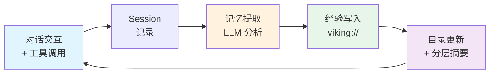

# OpenViking 源码解读 —— 给 AI Agent 一个"文件系统大脑"

> 字节跳动火山引擎出品 · Apache 2.0 · GitHub 13K+ stars · Self-evolving Context Database for AI Agents

---

## 0. 引言：从"扁平向量"到"结构化文件系统"

当前所有 Agent 记忆系统都面临一个根本矛盾：**LLM 的无状态性，与人类知识的结构化本质之间的张力。**

传统的 RAG 方案把上下文当成扁平文本块的集合——切块、嵌入、相似度排序、Top-K 注入 prompt。这套流水线在"找到相关文档"这个场景下足够好，但当 Agent 需要理解"哪些信息属于哪个项目"、"这段经验上次用是什么时候"、"下次类似任务应该走什么路径"时，扁平向量的局限性就暴露无遗。

具体来说，Agent 记忆系统有五个顽疾：

| 顽疾 | 表现 | 传统方案的无力 |
|------|------|----------------|
| 上下文碎片化 | 文档、代码、记忆散落在多个独立存储中 | 没有一个统一命名空间 |
| Token 成本飙升 | 一次性加载全部相关文档到 prompt | 没有分层按需加载机制 |
| 检索质量差 | 纯语义相似度无法精确定位到"哪个目录" | 没有结构化导航能力 |
| 可观测性差 | 黑盒 RAG 管道，无法回溯 Agent 为什么选了这段上下文 | 没有检索轨迹记录 |
| 记忆迭代弱 | Agent 每次交互都是"用完即丢" | 没有从 Session 中提取经验并持续积累的机制 |

**OpenViking 的定位正是填补这些空白：Self-evolving Context Database for AI Agents——给 AI Agent 一个"文件系统大脑"。**

用 `viking://` 协议将所有 Agent 上下文组织成层次化目录结构，让 Agent 像开发者浏览代码库一样浏览自己的"记忆"。写入时自动生成 L0/L1 摘要，检索时按目录递归下钻，交互后自动提取经验并写入 viking:// 目录。

本文将从源码层拆解这套系统的核心设计：虚拟文件系统、分层上下文加载、目录递归检索、自演进记忆机制，以及它与 Mem0、TencentDB Agent Memory、Letta 的定位差异。

---

## 1. 项目全景

### 1.1 核心设计哲学

OpenViking 的 README 用一句话概括了整个项目的愿景：

> **A Self-evolving Context Database for AI Agents**

这个定位包含了三个关键概念：

1. **Self-evolving（自演进）**：记忆不是静态存储，而是从每次交互中提取经验、持续进化
2. **Context Database（上下文数据库）**：不是简单的向量库，而是结构化的上下文管理系统
3. **for AI Agents（为 Agent 而生）**：不是给人用的知识库，而是给 Agent 用的"文件系统大脑"

### 1.2 解决五大痛点

OpenViking 针对上述五个顽疾，给出了系统性的解决方案：

| 痛点 | 传统方案 | OpenViking 方案 |
|------|---------|----------------|
| 上下文碎片化 | 多个独立存储（向量库 + 文件系统 + 数据库） | `viking://` 统一命名空间，所有上下文一个 URI |
| Token 成本飙升 | 一次性加载全部相关 Chunk | L0/L1/L2 分层按需加载，按需下钻 |
| 检索质量差 | 扁平向量相似度匹配 | 目录递归检索，先定位目录再精确查找 |
| 可观测性差 | 黑盒 RAG 管道 | 可视化检索轨迹，回溯 Agent 的导航路径 |
| 记忆迭代弱 | 仅保留聊天日志 | Session 提取 + 自演进循环，越用越聪明 |

### 1.3 源码目录结构

OpenViking 的代码库结构清晰，各模块职责分明：

```
OpenViking/
├── openviking/                    # Python SDK 核心
│   ├── __init__.py
│   ├── core/                      # 核心引擎（URI 解析、分层摘要、上下文注入）
│   │   ├── uri.py                 # viking:// URI 规范与解析
│   │   ├── summarizer.py          # L0/L1 摘要生成
│   │   └── context_loader.py      # 分层上下文加载
│   ├── models/                    # 数据模型（Memory、Resource、Skill）
│   ├── retrieval/                 # 检索模块
│   │   ├── directory_retriever.py # 目录递归检索
│   │   └── trajectory_logger.py   # 检索轨迹记录
│   ├── storage/                   # 存储后端
│   │   ├── vector_stores/         # 向量存储适配层
│   │   ├── file_store.py          # 文件系统存储
│   │   └── sqlite_store.py       # SQLite 元数据存储
│   ├── memory/                    # 记忆管理
│   │   ├── session.py             # Session 生命周期
│   │   └── extractor.py           # 记忆提取 Pipeline
│   ├── resource/                  # 资源管理（文档、代码、网页）
│   └── skill/                     # 技能管理
├── server/                        # HTTP 服务（端口 1933）
├── cli/                           # CLI 工具（ov 命令）
├── docs/                          # 文档
│   └── en/concepts/               # 概念说明
├── examples/                      # 示例代码
├── ov.conf                        # 配置文件模板
└── README.md
```

### 1.4 项目背景

- **出品方**：字节跳动火山引擎
- **许可证**：Apache 2.0
- **GitHub Stars**：13K+
- **定位**：Self-evolving Context Database for AI Agents
- **对标方案**：Mem0、Letta、TencentDB Agent Memory

---

## 2. 核心架构：viking:// 虚拟文件系统

### 2.1 什么是 viking://

OpenViking 的核心创新是 `viking://` URI 协议——它不是一个新的网络协议，而是一个**虚拟文件系统的命名空间**，将所有 Agent 上下文组织成层次化目录结构。

```
viking://
├── resources/                           # 资源：项目文档、代码库、网页等
│   └── my_project/
│       ├── docs/
│       │   ├── api/
│       │   │   ├── authentication.abstract
│       │   │   ├── authentication.overview
│       │   │   └── authentication.md
│       │   └── tutorials/
│       └── src/
└── user/                                # 用户上下文
    └── alice/
        ├── memories/                    # 用户记忆
        │   ├── preferences/
        │   │   ├── coding_language.abstract
        │   │   ├── coding_language.overview
        │   │   └── coding_language.md
        │   └── tools/
        ├── resources/                   # 用户私有资源
        │   └── private_project/
        ├── skills/                      # 用户技能
        │   ├── search_code.abstract
        │   ├── search_code.overview
        │   └── search_code.md
        └── peers/                       # 对等体（如其他 Agent）
            └── web-visitor-alice/
```

这个结构对任何用过 Linux 文件系统的开发者来说都是零学习成本的——目录、文件、路径、权限，一切直观。

### 2.2 三种上下文类型

| 类型 | 路径 | 说明 | 典型内容 |
|------|------|------|---------|
| **Resources** | `viking://resources/` | 项目文档、代码库、网页等外部知识 | API 文档、运维手册、代码库 |
| **User Memories** | `viking://user/{user_id}/memories/` | 用户偏好、习惯、工具使用经验 | 编码偏好、沟通风格、最佳实践 |
| **Agent Skills** | `viking://user/{user_id}/skills/` | Agent 可调用的能力和工具定义 | 工作流定义、模板、检查清单 |

### 2.3 源码中的 URI 解析

URI 解析模块负责将 `viking://user/alice/memories/preferences/coding_language` 这样的外部 URI 映射为内部文件路径：

```python
# openviking/core/uri.py

class VikingURI:
    """解析和验证 viking:// URI"""
    
    SCHEME = "viking"
    ROOTS = {"resources", "user"}
    
    def __init__(self, uri: str):
        parsed = urlparse(uri)
        if parsed.scheme != self.SCHEME:
            raise ValueError(f"Invalid scheme: {parsed.scheme}")
        
        self.root = parsed.netloc       # e.g., "user"
        self.path = parsed.path         # e.g., "/alice/memories/preferences/coding_language"
        self.parts = [p for p in self.path.split("/") if p]
    
    def resolve(self, base_dir: str) -> str:
        """将 URI 映射为物理路径"""
        if self.root == "resources":
            return os.path.join(base_dir, "resources", *self.parts)
        elif self.root == "user":
            return os.path.join(base_dir, "user", *self.parts)
        else:
            raise ValueError(f"Unknown root: {self.root}")
    
    def validate_access(self, user_id: str) -> bool:
        """权限检查：user 根目录下的路径只能被对应 user_id 访问"""
        if self.root == "user" and self.parts[0] != user_id:
            return False
        return True
```

URI 解析的关键设计点：
- **根目录验证**：只允许 `resources` 和 `user` 两个根
- **路径安全**：防止 `../` 路径穿越攻击
- **权限隔离**：`user/{user_id}/` 天然实现了用户级隔离

---

## 3. L0/L1/L2 分层上下文加载

### 3.1 三层架构定义

L0/L1/L2 是 OpenViking 最引人注目的特性——每个文件都有三个层级的表述：

| 层级 | 名称 | Token 估算 | 用途 | 对应文件 |
|------|------|-----------|------|---------|
| **L0** | Abstract | ~100 tokens | 一句话摘要，快速识别和廉价检索 | `.abstract` |
| **L1** | Overview | ~2K tokens | 核心信息 + 使用场景，规划决策 | `.overview` |
| **L2** | Full Content | 完整内容 | 深度阅读，仅在需要时加载 | 原始文件（`.md`、`.py` 等） |

### 3.2 按需加载流程

这是 OpenViking 区别于传统 RAG 的关键机制——**不是"全部加载"，而是"按需下钻"**：

```
                    Agent 查询
                        │
                        ▼
        ┌───────────────────────────────┐
        │  Step 1: 扫描 L0 摘要          │
        │  ~100 tokens × N 个文件        │
        │  快速初筛，找出候选集           │
        └───────────────┬───────────────┘
                        │
                        ▼
        ┌───────────────────────────────┐
        │  Step 2: 加载 Top-K L1 概览    │
        │  ~2K tokens × K 个文件         │
        │  精选高相关内容                 │
        └───────────────┬───────────────┘
                        │
                        ▼
        ┌───────────────────────────────┐
        │  Step 3: 加载最相关的 L2 全文  │
        │  按需深度处理                  │
        └───────────────────────────────┘
```

这个流程的本质是**信息漏斗**：用极小的 Token 代价（L0 扫描）快速缩小范围，用中等代价（L1 概览）精选内容，最后才加载最昂贵的完整内容（L2）。

### 3.3 实战案例：50 个内部 Runbook

假设 Agent 需要查找某个运维问题的解决方案，公司有 50 个内部 Runbook：

| 方案 | Token 消耗 | 说明 |
|------|-----------|------|
| 传统 RAG（加载全部 Chunk） | 50K+ tokens | 所有相关文档一次性注入 prompt |
| OpenViking L0 扫描 | ~5K tokens | 50 × 100 tokens = 5K，快速定位到 3 个候选 |
| OpenViking L0 → L1 精选 | ~11K tokens | 5K + 3 × 2K = 11K，精选出 1 个最相关 |
| OpenViking L0 → L1 → 1 个 L2 | ~13K tokens | 11K + 2K 全文 = ~13K，深度处理 |

**Token 节省：70-90%**。对于上下文窗口有限的场景，这意味着 Agent 可以同时处理更多的 Runbook，而不必担心 prompt 溢出。

### 3.4 写入时自动生成

L0 和 L1 不是手动编写的，而是**写入 L2 时由 LLM 自动生成**：

```python
# openviking/core/summarizer.py

class LayeredSummarizer:
    """为写入的内容自动生成 L0 和 L1 摘要"""
    
    def __init__(self, llm_client, vlm_config):
        self.llm = llm_client
        self.config = vlm_config
    
    async def generate(self, content: str) -> Tuple[str, str]:
        """生成 L0 Abstract 和 L1 Overview"""
        
        # L0: 一句话摘要（~100 tokens）
        l0_prompt = f"Summarize the following in ONE sentence:\n\n{content[:2000]}"
        l0 = await self.llm.complete(l0_prompt, max_tokens=100)
        
        # L1: 核心信息 + 使用场景（~2K tokens）
        l1_prompt = f"""Summarize the following content focusing on:
1. Core information
2. Usage scenarios
3. Key points

Content:
{content[:4000]}"""
        l1 = await self.llm.complete(l1_prompt, max_tokens=2000)
        
        return l0, l1
```

这个设计的关键取舍：
- **写入时生成**：避免检索时临时生成导致延迟增加
- **限制输入长度**：截断到 2000-4000 字符，控制摘要生成的 Token 消耗
- **异步处理**：摘要生成不影响写入的即时返回

### 3.5 分层文件的存储规则

每个逻辑文件在物理存储上对应三个文件：

```
~/.openviking/data/user/alice/memories/preferences/
├── coding_language.abstract    # L0 (~100 tokens)
├── coding_language.overview    # L1 (~2K tokens)
└── coding_language.md          # L2 (原始内容)
```

存储路径规则：
- 同一基名前缀，不同后缀区分层级
- 所有文件在同一目录，便于批量操作
- `.abstract` 和 `.overview` 是纯文本文件，内容格式与 L2 一致（Markdown）

---

## 4. 检索层：目录递归检索（Directory Recursive Retrieval）

### 4.1 传统 RAG vs 目录递归检索

| 维度 | 传统 RAG | OpenViking |
|------|---------|------------|
| 检索单位 | 扁平 Chunk | 目录 + 文件 |
| 定位精度 | 语义相似度（全局排序） | 目录定位 + 目录内语义检索 |
| 上下文感知 | 无（不知道结果属于哪个项目） | 知道结果在哪个目录、哪个层级 |
| 递归能力 | 无 | 支持子目录递归下钻 |
| 可解释性 | 低（为什么返回这段？） | 高（因为在这个目录下，且语义匹配） |

### 4.2 检索流程

```
                    查询 (query)
                        │
                        ▼
        ┌───────────────────────────────┐
        │  向量检索（全局 L0 摘要扫描）   │
        │  定位 Top-N 高评分目录         │
        └───────────────┬───────────────┘
                        │
                        ▼
        ┌───────────────────────────────┐
        │  在目标目录内进行二次检索       │
        │  目录内 L1/L2 精确匹配         │
        └───────────────┬───────────────┘
                        │
                        ▼
        ┌───────────────────────────────┐
        │  需要更深？递归进入子目录       │
        │  重复向量检索 → 二次检索       │
        └───────────────┬───────────────┘
                        │
                        ▼
        ┌───────────────────────────────┐
        │  返回带上下文的检索结果         │
        │  （包含文件路径、层级信息）     │
        └───────────────────────────────┘
```

### 4.3 源码解析

```python
# openviking/retrieval/directory_retriever.py

class DirectoryRetriever:
    """目录递归检索器"""
    
    def __init__(self, vector_store, config):
        self.vector_store = vector_store
        self.max_depth = config.get("max_depth", 3)
        self.top_k_per_level = config.get("top_k", 5)
    
    async def retrieve(self, query: str, root_path: str, depth: int = 0) -> List[RetrievalResult]:
        """递归检索"""
        if depth >= self.max_depth:
            return []
        
        # Step 1: 在当前目录的 L0 摘要中进行向量检索
        l0_results = await self.vector_store.search(
            query=query,
            scope=f"{root_path}/**/*.abstract",
            top_k=self.top_k_per_level
        )
        
        results = []
        for match in l0_results:
            # Step 2: 定位到具体目录
            target_dir = os.path.dirname(match.file_path)
            
            # Step 3: 在目标目录内精确检索（L1/L2）
            precise_results = await self._retrieve_precise(query, target_dir)
            results.extend(precise_results)
            
            # Step 4: 如果需要更深，递归子目录
            if depth < self.max_depth - 1:
                sub_dirs = self._list_subdirs(target_dir)
                for sub_dir in sub_dirs:
                    sub_results = await self.retrieve(query, sub_dir, depth + 1)
                    results.extend(sub_results)
        
        return self._deduplicate_and_rank(results)
    
    async def _retrieve_precise(self, query: str, target_dir: str) -> List[RetrievalResult]:
        """在目标目录内进行精确检索（L1/L2）"""
        # 优先检索 L1 Overview
        l1_results = await self.vector_store.search(
            query=query,
            scope=f"{target_dir}/*.overview",
            top_k=3
        )
        
        # 对高评分结果，可选加载 L2 全文
        precise_results = []
        for match in l1_results:
            if match.score > 0.85:
                l2_content = self._load_full_content(match.file_path)
                precise_results.append(RetrievalResult(
                    content=l2_content,
                    file_path=match.file_path,
                    level="L2",
                    score=match.score
                ))
            else:
                precise_results.append(RetrievalResult(
                    content=match.content,
                    file_path=match.file_path,
                    level="L1",
                    score=match.score
                ))
        
        return precise_results
```

核心算法逻辑：
1. **L0 扫描定位目录**：用最便宜的 L0 摘要做全局向量检索
2. **目录内精确检索**：在定位到的目录内用 L1 做精确匹配
3. **阈值驱动的 L2 加载**：只有 score > 0.85 才加载全文
4. **递归下钻**：最大深度可配置（默认 3 层）
5. **去重排序**：合并多轮检索结果，按 score 去重排序

### 4.4 检索轨迹可视化（Visualized Retrieval Trajectory）

每次检索的路径都会被记录，开发者可回溯 Agent 的导航过程：

```
检索轨迹示例（query: "how does auth work"）：

viking://resources/
└── my_project/
    └── docs/                    ← L0 扫描命中（score: 0.92）
        └── api/                 ← 递归进入（depth=1）
            ├── authentication   ← L1 精确匹配（score: 0.88）
            │   └── 加载 L2 全文  ← score > 0.85，加载全文
            └── authorization    ← L1 精确匹配（score: 0.76）
                └── 仅返回 L1     ← score < 0.85，不加载全文
```

这种轨迹记录对于调试 Agent 行为、优化检索策略、理解 Agent 的"思考路径"至关重要。传统 RAG 管道是黑盒的——你只知道返回了什么，不知道 Agent 是怎么找到的。OpenViking 让整个过程可回溯、可调试。

---

## 5. Session 记忆与自演进机制（重点）

### 5.1 什么是"自演进"

> Agent 不是用完即丢的工具，而是随着使用不断积累经验的"伙伴"。

这是 OpenViking 与其他记忆方案最大的区别。传统方案中，Agent 每次完成任务后，对话记录要么被丢弃，要么存进聊天日志——但**没有从交互中提取经验并结构化的能力**。

OpenViking 的自演进机制让 Agent 的每一次交互都成为下一次交互的养料：



### 5.2 Session 生命周期

```
创建 Session → 添加消息 → 提交 Session → 异步提取记忆 → 更新 User/Agent 目录 → 下次受益
```

Session 的状态机：

```
active ──[commit()]──→ committed ──[extract_async()]──→ extracting ──[done()]──→ done
  │                                                               │
  └────[add_message()]────────────────────────────────────────────┘
```

- `active`：Session 进行中，可添加消息
- `committed`：Session 提交，消息不可再修改
- `extracting`：记忆提取异步执行中
- `done`：提取完成，Session 关闭

```python
# openviking/memory/session.py

class Session:
    """Session 生命周期管理"""
    
    def __init__(self, session_id: str, user_id: str, extractor: MemoryExtractor):
        self.session_id = session_id
        self.user_id = user_id
        self.state = "active"
        self.messages = []
        self.tool_calls = []
        self.extractor = extractor
    
    def add_message(self, role: str, content: str):
        """添加对话消息"""
        if self.state != "active":
            raise SessionError(f"Cannot add message to {self.state} session")
        self.messages.append({"role": role, "content": content})
    
    def add_tool_call(self, tool_name: str, args: dict, result: str):
        """记录工具调用"""
        self.tool_calls.append({
            "tool": tool_name,
            "args": args,
            "result": result
        })
    
    async def commit(self):
        """提交 Session，触发异步记忆提取"""
        self.state = "committed"
        asyncio.create_task(self._extract_and_store())
    
    async def _extract_and_store(self):
        self.state = "extracting"
        
        # 提取记忆
        memories = await self.extractor.extract(
            messages=self.messages,
            tool_calls=self.tool_calls
        )
        
        # 写入 viking:// 目录
        for memory in memories:
            await self._write_to_viking(memory)
        
        self.state = "done"
```

### 5.3 记忆提取机制（Memory Extraction）

#### 5.3.1 提取触发时机

| 触发方式 | 说明 |
|---------|------|
| **自动触发** | Session 提交时自动调用 `session.commit()`，内部触发异步提取 |
| **手动触发** | `session.extract_memories()` 手动触发 |
| **异步执行** | `asyncio.create_task()` 后台执行，不阻塞 Session 提交 |

异步设计的关键考量：
- Session 提交需要立即返回，不能等 LLM 提取完成
- 提取失败不影响 Session 的正常关闭
- 提取进度可通过状态机查询

#### 5.3.2 提取输入

记忆提取的输入是一轮完整的交互记录：

```python
@dataclass
class ExtractionInput:
    messages: List[Message]           # user + assistant 对话
    tool_calls: List[ToolCall]        # 工具调用记录（含参数和结果）
    task_result: TaskResult           # 任务执行结果（success/failure/partial）
    user_feedback: Optional[Feedback] # 用户反馈（评分/评论/隐式信号）
```

- **对话消息**：用户说了什么、Agent 回了什么
- **工具调用**：Agent 用了哪些工具、参数是什么、结果如何
- **任务结果**：任务是否成功完成、部分完成、还是失败
- **用户反馈**：显式评分或隐式信号（如用户是否采纳了建议）

#### 5.3.3 提取输出分类

提取的记忆按类型路由到不同的 viking:// 路径：

| 提取目标 | 目标路径 | 说明 | 示例 |
|---------|---------|------|------|
| **用户偏好** | `user/{user_id}/memories/preferences/` | 写作风格、编码习惯、沟通偏好 | "用户总是用 Python 而不是 JS" |
| **工具经验** | `user/{user_id}/memories/tools/` | 工具使用技巧、常见错误、最佳实践 | "grep 比 find 在这个场景更快" |
| **技能经验** | `user/{user_id}/memories/skills/` | 工作流策略、任务分解模式 | "这类任务通常分三步：调研→实现→测试" |
| **Agent 经验** | `user/{user_id}/memories/agent_experience/` | Agent 自身的操作经验和教训 | "在 monorepo 中搜索时应排除 node_modules" |

### 5.4 自演进循环：从记忆到能力的进化

OpenViking 的自演进不是简单的"记住对话"，而是**从对话中提取经验、结构化存储、下次交互时自动生效**的完整循环：

```
┌─────────────────────────────────────────────────────────────────┐
│                    OpenViking 自演进循环                          │
│                                                                 │
│  ┌──────────────┐     ┌──────────────┐     ┌───────────────┐    │
│  │  对话交互     │────→│  Session     │────→│  记忆提取      │    │
│  │  + 工具调用   │     │  记录        │     │  (LLM 分析)   │    │
│  └──────────────┘     └──────────────┘     └───────┬───────┘    │
│       ↑                                            │            │
│       │                                            ↓            │
│  ┌──────────────┐     ┌──────────────┐     ┌───────────────┐    │
│  │  下次受益     │←────│  目录更新     │←────│  经验写入      │    │
│  │ (更准/更好)   │     │ + 分层摘要   │     │  viking://    │    │
│  └──────────────┘     └──────────────┘     └───────────────┘    │
│                                                                 │
│  每一次交互 → 记忆增长 → 下一次更智能                              │
└─────────────────────────────────────────────────────────────────┘
```

这个循环的本质是**经验累积**：Agent 不是一开始就知道所有最佳实践，而是在使用过程中逐步积累的。

#### 5.4.1 第一阶段：记住偏好（用户记忆）

```
第一次交互："我喜欢用 TypeScript 写后端"
  ↓ 提取
viking://user/alice/memories/preferences/coding_language
├── .abstract   (L0): "用户偏好 TypeScript 作为后端语言"
├── .overview   (L1): "用户 Alice 在前后端项目中统一使用 TypeScript，
│                    偏好 Node.js 运行时，熟悉 Express 和 Fastify 框架"
└── .md         (L2): [完整对话记录]

下次交互时：
  Agent 自动检索到这条偏好 → 在生成代码时优先选择 TypeScript
  → 无需用户重复说明
```

#### 5.4.2 第二阶段：积累经验（工具经验）

```
多次使用同一工具后的经验沉淀：

交互1：Agent 用 grep 搜索，超时
交互2：Agent 用 find 搜索，遗漏文件
交互3：Agent 发现 ripgrep 更快更准
  ↓ 提取
viking://user/alice/memories/tools/search_code
├── .abstract   (L0): "在大型 monorepo 中搜索代码的最佳实践"
├── .overview   (L1): "对于 >1000 个文件的 monorepo，使用 ripgrep 而非 grep，
│                    排除 node_modules 和 dist 目录，使用 --type=ts 过滤"
└── .md         (L2): [完整对话记录 + 工具调用结果对比]

下次搜索代码时：
  Agent 自动选择 ripgrep + 正确的过滤参数 → 不再重复试错
```

#### 5.4.3 第三阶段：形成技能（Skill 化）

```
反复验证的工作流 → Skill 定义：

多次完成代码审查任务后：
  ↓ 提取 + 结构化
viking://user/alice/skills/code_review
├── .abstract   (L0): "代码审查工作流"
├── .overview   (L1): "审查流程：1. 检查测试覆盖率 → 2. 审查核心逻辑 →
│                    3. 检查边界情况 → 4. 生成审查报告"
└── .md         (L2): [完整工作流定义 + 模板 + 检查清单]

下次接到代码审查任务时：
  Agent 自动加载这个 Skill → 按标准流程执行 → 输出一致的审查报告
```

**从"记住偏好"到"积累经验"再到"形成技能"——这就是"自演进"的完整路径。**

### 5.5 记忆提取的 Prompt 设计

```python
# openviking/memory/extractor.py

EXTRACTION_PROMPT = """
Analyze the following conversation and tool interactions to extract actionable memories.

Rules:
1. Extract USER PREFERENCES (coding style, communication style, tool preferences)
2. Extract TOOL EXPERIENCE (what worked, what failed, best practices)
3. Extract TASK PATTERNS (common workflows, task decomposition strategies)
4. Extract AGENT EXPERIENCE (Agent's own lessons learned)
5. DO NOT extract temporary or context-specific information
6. DO NOT extract information that contradicts existing memories
7. Distinguish between user preferences and objective facts

Conversation:
{messages}

Tool Calls:
{tool_calls}

Task Result: {task_result}

Output format (JSON):
{{
  "preferences": [...],
  "tool_experience": [...],
  "task_patterns": [...],
  "agent_experience": [...]
}}
"""
```

Prompt 设计的关键点：
- **四类提取目标**：偏好、工具经验、任务模式、Agent 经验
- **排除规则**：不提取临时信息、不提取矛盾信息
- **区分偏好与事实**：用户偏好和客观事实需要分开处理

### 5.6 冲突处理与去重

当提取的记忆与已有记忆冲突或高度相似时：

| 场景 | 处理策略 |
|------|---------|
| 完全重复 | 不写入，记录访问时间（更新 freshness） |
| 部分重叠 | 合并为一条，保留更完整的表述 |
| 矛盾信息 | 保留两条，标注时间戳和来源，由检索时按时间优先级选择 |
| 过期信息 | 标记为 deprecated，新信息作为主记忆 |

### 5.7 Benchmark 验证数据

#### LoCoMo 用户记忆评估（LoCoMo10 数据集）

| 指标 | OpenClaw (memory-core) | OpenClaw + OpenViking |
|------|----------------------|----------------------|
| 任务完成率 | 35.65% | **52.08%** |
| 输入 Token | 24,611,530 | **4,264,396** |
| Token 减少 | — | **-82.7%** |

#### Agent 经验评估（tau2-bench）

| 场景 | 无记忆 | 有经验记忆 | 提升 |
|------|--------|-----------|------|
| Retail（零售） | 基准 | +6.87pp | 任务成功率提升 |
| Airline（航空） | 基准 | +11.87pp | 任务成功率提升 |

#### 数据解读

- **任务完成率提升 16.43pp**：证明提取的记忆被有效利用，不是"存了没用"
- **Token 减少 82.7%**：L0/L1 分层 + 精准检索避免了大量无关上下文注入 prompt
- **Airline 场景提升更大（+11.87pp vs +6.87pp）**：复杂任务（涉及多步骤、多约束）更需要经验积累

---

## 6. 存储层与向量引擎

### 6.1 向量存储架构

OpenViking 的向量存储是一个**可插拔的适配层**，默认使用本地向量索引，同时支持多种外部向量数据库：

```python
# openviking/storage/vector_stores/base.py

class BaseVectorStore(ABC):
    """向量存储抽象接口"""
    
    @abstractmethod
    async def upsert(self, items: List[VectorItem]) -> List[str]:
        """插入或更新向量"""
        pass
    
    @abstractmethod
    async def search(self, query: str, scope: str = None, top_k: int = 10) -> List[SearchResult]:
        """语义检索，支持 scope 过滤"""
        pass
    
    @abstractmethod
    async def delete(self, ids: List[str]) -> None:
        """删除向量"""
        pass
```

### 6.2 支持的向量后端

| 后端 | 适用场景 | 部署复杂度 | 说明 |
|------|---------|-----------|------|
| 本地索引 | 开发/测试/轻量生产 | 零 | 基于 FAISS 或类似引擎 |
| Qdrant | 生产环境 | 低 | 支持本地和云端部署 |
| Milvus | 大规模生产 | 中 | 分布式向量数据库 |
| pgvector | 已有 Postgres | 低 | Postgres 扩展 |
| Chroma | 轻量级应用 | 低 | 嵌入式向量库 |

### 6.3 嵌入模型配置

```yaml
# ov.conf

models:
  embedding:
    provider: openai                    # 或 qwen, volcengine, litellm
    model: text-embedding-3-large       # OpenAI 默认模型
    api_key: ${OPENAI_API_KEY}
    dimensions: 3072                    # embedding 维度
```

也可使用自托管模型：

```yaml
models:
  embedding:
    provider: qwen
    model: Qwen3-Embedding-0.6B        # 自托管，1024 维
    endpoint: http://localhost:8000/v1
    dimensions: 1024
    matryoshka: true                    # 支持 Matryoshka 降维
```

### 6.4 VLM 模型配置（用于 L0/L1 生成）

```yaml
models:
  vlm:
    provider: openai                    # 或 volcengine, litellm
    model: gpt-4-vision-preview         # 用于摘要生成和图片理解
    api_key: ${OPENAI_API_KEY}
```

VLM 模型的用途：
- **L0/L1 摘要生成**：写入内容时自动生成
- **图片理解**：处理包含图片的 Resource

### 6.5 文件存储与元数据

```
~/.openviking/data/
├── resources/              # 资源文件（原始内容 + 摘要）
├── user/                   # 用户文件
├── vectors/                # 向量索引（FAISS/HNSW 文件）
└── metadata.db             # SQLite 元数据库
```

- **SQLite 元数据库**：存储文件元信息、标签、权限等
- **本地文件系统**：存储原始内容和摘要文件
- **向量索引文件**：存储嵌入向量（FAISS 格式）

---

## 7. 客户端接入

### 7.1 REST API

OpenViking Server 监听端口 **1933**，提供 OpenAI-style REST API：

| 端点 | 方法 | 用途 |
|------|------|------|
| `/v1/resources` | POST | 添加资源 |
| `/v1/resources/{id}` | GET | 获取资源 |
| `/v1/find` | POST | 语义检索 |
| `/v1/sessions` | POST | 创建 Session |
| `/v1/sessions/{id}/commit` | POST | 提交 Session |

认证方式：`X-API-Key` Header

### 7.2 Python SDK

```python
import openviking as ov

# 初始化客户端
client = ov.SyncHTTPClient(
    url="https://your-openviking-server:1933",
    api_key="your-api-key"
)

# 验证连接
client.initialize()

# 语义检索
results = client.find("how does authentication work")

# 添加资源
client.add_resource(
    url="https://github.com/your-org/your-repo",
    path="viking://resources/my_project/"
)

# 清理
client.close()
```

### 7.3 CLI 工具（ov）

```bash
# 查看状态
ov status

# 添加资源
ov add-resource https://github.com/your-org/your-repo

# 检索
ov find "how does config work"

# 查看 Session
ov session list
```

CLI 配置文件：`~/.openviking/ovcli.conf`

### 7.4 SDK 核心源码

```python
# openviking/client.py

class SyncHTTPClient:
    """同步 HTTP 客户端"""
    
    def __init__(self, url: str, api_key: str):
        self.base_url = url.rstrip("/")
        self.headers = {"X-API-Key": api_key}
        self.session = requests.Session()
        self.session.headers.update(self.headers)
    
    def initialize(self):
        """验证连接"""
        resp = self.session.get(f"{self.base_url}/health")
        resp.raise_for_status()
    
    def find(self, query: str, root: str = None, top_k: int = 10) -> List[Result]:
        """语义检索"""
        resp = self.session.post(
            f"{self.base_url}/v1/find",
            json={"query": query, "root": root, "top_k": top_k}
        )
        resp.raise_for_status()
        return [Result.from_dict(r) for r in resp.json()["results"]]
```

---

## 8. 与 Agent 框架集成

### 8.1 OpenClaw 插件集成

`openviking-openclaw` 插件将 OpenViking 作为 OpenClaw 的记忆后端：

```yaml
# OpenClaw 配置
memory:
  provider: openviking
  url: http://localhost:1933
  api_key: ${OV_API_KEY}
  user_id: ${USER_ID}
```

在 LoCoMo10 数据集评估中，OpenClaw + OpenViking 比 OpenClaw 内置 memory-core 的任务完成率提升了 **16.43pp**，同时 Token 消耗降低了 **82.7%**。

### 8.2 LangGraph / CrewAI 集成

OpenViking 可作为 Context Provider 接入任何 Agent 框架：

```python
# LangGraph 集成
from openviking import SyncHTTPClient

client = SyncHTTPClient(url=OV_URL, api_key=OV_KEY)

def context_retriever(state):
    """从 OpenViking 检索上下文"""
    results = client.find(state["query"])
    return {"context": "\n".join(r.content for r in results)}
```

### 8.3 MCP 兼容

OpenViking 的 REST API 兼容 OpenAI-style `file_search` 和 `vectorstore` API，因此可以直接作为 MCP server 的后端：

```json
{
  "mcpServers": {
    "openviking": {
      "command": "npx",
      "args": ["-y", "@openviking/mcp-server"],
      "env": {
        "OV_URL": "http://localhost:1933",
        "OV_API_KEY": "your-key"
      }
    }
  }
}
```

---

## 9. 对比分析：OpenViking vs Mem0 / TencentDB / Letta

### 9.1 与 Mem0 对比

| 维度 | OpenViking | Mem0 |
|------|-----------|------|
| 核心理念 | 文件系统范式，结构化导航 | 通用记忆层，LLM 提取 + 向量检索 |
| 上下文组织 | `viking://` 层次目录 | User/Session/Agent 扁平存储 |
| 检索方式 | 目录递归检索 + 语义搜索 | 三路混合（语义 + BM25 + 实体） |
| Token 优化 | L0/L1/L2 分层按需加载 | 多信号检索过滤（~7K/call） |
| 可观测性 | ✅ 可视化检索轨迹 | ❌ |
| 时序推理 | ❌ | ✅ 写入分类 + 查询重排 |
| 记忆衰减 | ❌ | ✅ 内置衰减函数 |
| 自演进 | ✅ Session 提取 + 目录更新 | ❌ 仅 ADD-only 提取 |
| 社区规模 | 13K stars | 62K stars |

**定位差异**：OpenViking 是"结构化上下文数据库"，强在导航和可观测性；Mem0 是"通用记忆层"，强在接入简单和后端可插拔。前者适合需要精确上下文定位的场景，后者适合快速嵌入记忆能力的应用。

### 9.2 与 TencentDB Agent Memory 对比

| 维度 | OpenViking | TencentDB Agent Memory |
|------|-----------|----------------------|
| 记忆分层 | L0/L1/L2（抽象/概览/全文） | L0→L1→L2→L3 四级蒸馏 |
| 提取策略 | LLM 自动生成摘要 + Session 提取 | LLM 分层蒸馏 + 知识图谱 |
| 存储后端 | 向量库 + 文件系统 | SQLite + 本地文件 |
| 团队治理 | 基础 user_id 隔离 | 四级 ACL + Agent Loadout + Memory Hub |
| 符号记忆 | ❌ | Mermaid 符号图卸载 |
| 代码理解 | Resources 索引（含代码库） | CodeGraph 调用关系图 |
| 可观测性 | ✅ 检索轨迹可视化 | 基础日志 |
| 自演进 | ✅ Session 提取 + 经验写入 | ✅ Chat Memory 蒸馏 + Skill 提取 |
| 部署复杂度 | 中（Docker / Kustomize） | 中（Docker + LLM API） |

**定位差异**：OpenViking 的 L0/L1/L2 分层加载在 Token 优化上更激进（82.7% 减少）；TencentDB Agent Memory 在团队治理和协作上更深入（ACL、Agent Loadout、Memory Hub）。

### 9.3 与 Letta（MemGPT）对比

| 维度 | OpenViking | Letta |
|------|-----------|-------|
| 核心理念 | 外部上下文数据库 | LLM 自主管理记忆（OS 范式） |
| 上下文结构 | 文件系统目录 | 核心/档案/上下文窗口 |
| 检索控制 | 目录递归 + 分层加载 | LLM 自主调用工具 |
| 多 Agent | user_id 隔离 | 需外部编排 |
| 自演进 | Session 提取 + 目录更新 | 反思 + 上下文管理 |
| 开发成本 | 低（pip install） | 中（需要理解 OS 范式） |

**架构本质差异**：Letta 让 LLM 自己管理记忆——Agent 有自主权决定什么时候读档案、什么时候搜索。OpenViking 则是外部的"文件系统大脑"——Agent 通过 `viking://` 协议浏览和检索。前者更自治但学习曲线更陡，后者更直观但需要外部服务。

### 9.4 四方案定位总结

```
自治性 ↑
  │
  │  Letta
  │  (LLM 自主管理)
  │
  │        Mem0
  │    (通用记忆层)
  │
  │    TencentDB
  │  (团队记忆中枢)
  │
  │ OpenViking
  │ (结构化上下文数据库)
  │
  └────────────────────────────→ 结构化程度
```

---

## 10. 个人思考与评价

### 10.1 OpenViking 的优势

1. **文件系统范式直观**：对开发者零学习成本，`viking://` 协议就像 `https://` 一样自然
2. **L0/L1/L2 分层加载是杀手级特性**：82.7% 的 Token 减少不是理论数字，而是真实 Benchmark 结果
3. **检索轨迹可视化填补了 RAG 可观测性的空白**：终于能看到 Agent 是怎么"思考"的
4. **自演进机制让 Agent 越用越聪明**：从偏好到经验到技能，三层递进
5. **开源社区增长迅速**：13K stars，字节跳动背书

### 10.2 OpenViking 的局限

1. **无时序推理能力**：不区分过去/现在/未来（Mem0 的三类 temporal 标签更完善）
2. **无记忆衰减机制**：不活跃的记忆不会自动降权，可能积累噪声
3. **团队级治理和 ACL 权限薄弱**：只有基础 user_id 隔离，没有四级 ACL 体系
4. **依赖外部 LLM 生成 L0/L1**：增加成本和延迟，且摘要质量依赖 LLM
5. **早期项目，API 仍在快速迭代**：接口稳定性不如 Mem0 等成熟方案
6. **对动态上下文支持有限**：实时变化的信息（如股票价格、系统状态）不适合这种"写入即归档"的模式

### 10.3 对 Agent Infra 方向的启示

1. **文件系统范式可能成为 Agent 上下文管理的标准模式**——Agent 也需要"浏览"自己的知识，就像开发者浏览代码库
2. **分层加载是解决 Token 成本问题的正确方向**——不是一次性加载所有相关内容，而是按需下钻
3. **检索可观测性应该是 Agent 框架的标配**——没有轨迹记录的 RAG 是黑盒
4. **自演进记忆是 Agent 从工具进化为伙伴的关键**——不记住经验的 Agent 永远是个新手
5. **"经验"应该像"记忆"一样被存储和检索**——不仅记住"用户说了什么"，更要记住"什么方法有效、什么方法无效"

---

## 11. 参考资料

1. OpenViking GitHub：https://github.com/volcengine/OpenViking
2. OpenViking OpenShift 部署：https://github.com/aicatalyst-team/openviking-openshift
3. OpenViking 文档：https://github.com/volcengine/OpenViking/tree/main/docs
4. MarkTechPost 解读：https://www.marktechpost.com/2026/03/15/meet-openviking/
5. Red Hat Developer 部署指南：https://developers.redhat.com/articles/2026/04/23/deploy-openviking-openshift-ai-improve-ai-agent-memory
6. Agent Context Wars 分析：https://pub.towardsai.net/the-agent-context-wars-three-battles-at-different-layers
7. OpenViking FAUN 解读：https://faun.pub/openviking-explained-reinventing-memory-and-context-for-ai-agents
8. Mem0 对比文档：https://github.com/2aronS/agent-git/blob/main/docs/src/comparisons/mem0.md
9. LoCoMo Benchmark 论文
10. tau2-bench Benchmark
